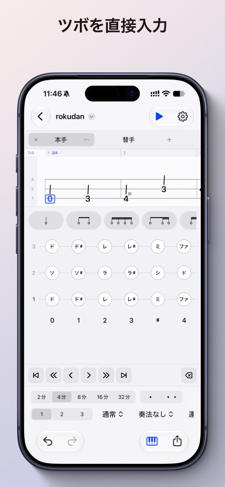
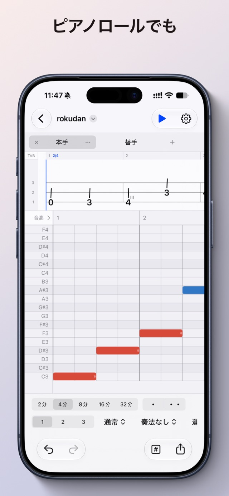
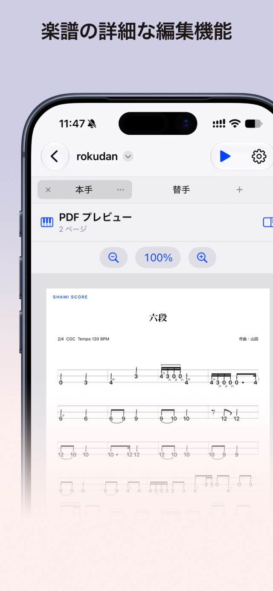

## 概要

ShamiScoreは、三味線奏者向けの採譜アプリです。津軽三味線の大学サークルに在籍していた際、既存の採譜ソフトが三味線にとって使いづらいと感じ、三味線に合った入力・編集体験を目指して開発を始めました。

iPadで扱いやすいアプリを目指し、iOS / iPadOS / macOS向けにApp Storeで公開しています。App Storeで157ダウンロードされています。将来的には、[shamisen.app](https://shamisen.app) を拠点に、アプリ紹介や譜面販売の導線を整える計画です。

<a href="https://apps.apple.com/app/id6767441963" target="_blank" rel="noopener noreferrer" style="display: inline-flex; align-items: center; gap: 0.5rem; padding: 0.625rem 1.25rem; border-radius: 0.5rem; background: #000; color: #fff; border: 1px solid var(--gray-700); font-weight: 600; text-decoration: none;"><svg xmlns="http://www.w3.org/2000/svg" width="20" height="20" viewBox="0 0 24 24" fill="currentColor" aria-hidden="true"><path d="M16.37 12.58c-.02-2.3 1.88-3.4 1.96-3.46-1.07-1.56-2.73-1.78-3.32-1.8-1.41-.14-2.76.83-3.47.83-.72 0-1.82-.81-2.99-.79-1.54.02-2.96.9-3.75 2.27-1.6 2.78-.41 6.89 1.15 9.14.76 1.1 1.67 2.34 2.86 2.3 1.15-.05 1.58-.74 2.97-.74 1.38 0 1.77.74 2.98.72 1.23-.02 2.01-1.12 2.76-2.23.87-1.28 1.23-2.52 1.25-2.58-.03-.01-2.39-.92-2.4-3.66zM14.1 5.83c.63-.77 1.06-1.83.94-2.89-.91.04-2.01.61-2.66 1.37-.58.68-1.1 1.76-.96 2.8 1.01.08 2.05-.52 2.68-1.28z"/></svg>App Storeでダウンロード</a>

## 担当

個人で開発しています。2022年に開発を始め、中断期間を挟みながら開発しています。Swiftはこのアプリで初めて使い、Appleのチュートリアルで学びました。SwiftUIを中心に、UIKit・AppKitも使って実装しています。

Beta版では、プロの三味線奏者・岩田桃楠さんから機能要望を受けて改善し、ご協力のもと代表曲「minimum」を採譜しました。作成した譜面は、同氏のコンサートで印刷・販売されました。

## 課題・工夫・結果

### ピアノロールと楽譜プレビューのスクロールを同期する

実装時、SwiftUIのScrollViewでは必要なスクロール量を取得できず、両画面を同期できませんでした。Stack Overflowの方法を参考にUIKit・AppKitを使って対応し、スクロールを戻したときや速く動かしたときも追従することを確認しました。

### 表示範囲だけを描画する

一譜面分の音符をすべて描くと動作が重くなるため、表示範囲だけを描画し、スクロールに合わせて描画対象を切り替えるようにしました。

### 再生前にオーディオエンジンを起動する

再生ボタンを押してから待たずに音が鳴るよう、オーディオエンジンを再生前に起動しておくようにしました。

